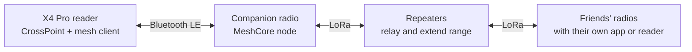

# The E-Reader That Texts Off-Grid: A Mesh Messaging Fork of CrossPoint for the Xteink X4 Pro

*By TMGCONMAN · October 2026 · Release [1.6.5-mesh.1](https://github.com/TMGCONMAN/crosspoint-reader/releases)*

Imagine an e-paper reader that can also exchange text messages where there is no cellular coverage. That is the premise of **1.6.5-mesh.1**, a community fork of the open-source CrossPoint Reader firmware for the Xteink X4 Pro. It integrates a complete MeshCore messaging client into the reader without compromising the reading experience.

The device pairs over Bluetooth Low Energy (BLE) with a compact MeshCore LoRa radio. LoRa, short for "long range," is a low-power radio technology that carries small data packets over long distances. MeshCore uses it to relay messages from node to node across a mesh network, with no cell towers or internet connection. The X4 Pro serves as the radio's display and keyboard, the role a smartphone app normally fills.

## Why build a messenger into an e-reader

The project began with a practical requirement: staying in contact with friends while camping, hiking or hunting beyond the reach of cellular networks. MeshCore already solves the networking problem. Inexpensive LoRa nodes forward short text messages to one another, and fixed repeaters extend coverage further.

The missing piece was a suitable front end. A smartphone works, but its battery is a scarce resource in the backcountry. E-paper is the opposite: the panel draws power only when the image changes, stays legible in direct sunlight, and is already in many packs. Turning the reader into the messaging terminal was the logical next step.

## How it works

The X4 Pro has no LoRa transceiver of its own, so it does not join the mesh directly. Instead it acts as a client to a MeshCore **companion radio**, connecting over BLE with the same companion protocol the official MeshCore smartphone app uses. The radio remains the mesh node; the reader is its user interface.

The firmware is CrossPoint Reader 1.6.5 with the mesh client layered on top. All mesh-specific code in shared files sits behind a single compile-time flag, so the fork's other device targets still build the standard reader. Reading remains the priority: opening a book, Wi-Fi or USB file transfer powers the Bluetooth stack down immediately. Incoming messages queue on the radio, up to 16 at a time, and are delivered when you return to the home screen.

Bluetooth covers only the short hop between the reader and its radio. Beyond the radio, every message travels over LoRa, independent of any cellular network.

## Key features

**Messaging.** Pairing with a companion radio is a one-time step secured by a PIN; after that the reader reconnects automatically. It supports channel chat and direct messages, with conversation history stored on the SD card. Contacts can be marked as favourites, quick replies cut down on typing with the on-screen keyboard, and contacts and channels can be shared as QR codes. Public, hashtag and private channels, the last protected by a shared secret key, can be joined, shared and left.

**Radio management.** The reader can configure the radio's name, transmit power, frequency and location. It can also log in to repeaters and room servers to check their status, and run node discovery to see which stations are in range.

**Mesh Carousel home screen.** A new home theme presents recent books in a swipeable carousel, with the current title enlarged in the centre. Beneath it, a status banner shows the radio link. When messages arrive, the banner switches to a high-contrast alert with the unread count, the senders and the latest message; one tap opens the conversation.

**Apps.** A new Apps screen adds Notes (a multi-line editor with checklists), a Calculator, Chess and Checkers against a computer opponent, Sudoku and 2048.

**Improved cover handling.** The reader now detects cover art in books that do not declare it in their metadata, accepts a sidecar `Book.jpg` placed next to `Book.epub`, and generates a titled placeholder for books with no artwork at all.

## Under the hood

The X4 Pro is built on an ESP32-S3 system-on-chip with 16 MB of flash storage and 8 MB of PSRAM, the external working memory used for large buffers. Firmware space was the tightest constraint. The mesh client adds roughly 249 KB to the firmware image and 10 KB of static RAM. With all 35 interface languages compiled in, the 6.25 MB application partition reached 94.6% capacity, so the mesh build ships with an English-only interface, which recovers about 395 KB. Hyphenation of book text still supports every language.

| Build | Flash used | Static RAM |
| --- | --- | --- |
| Stock X4 Pro, all languages | 5.95 MB (90.8%) | 103.7 KB |
| Mesh, all languages | 6.20 MB (94.6%) | 113.5 KB |
| Mesh, English only | 5.80 MB (88.5%) | 113.5 KB |

Runtime memory is allocated only when it is needed. The mesh service's working state, about 12 KB, exists only while the Bluetooth link is active, and the contact table is sized to the radio's own capacity: 72 bytes per contact, or about 25 KB for 350 contacts. Sending a message costs a single e-ink refresh, because the chat screen waits for the radio to acknowledge the message before redrawing.

Over-the-air (OTA) updates are locked to the fork's own release channel, so an official CrossPoint release, which lacks the mesh client, cannot overwrite it by accident. The release passed 681 automated host tests and was validated on an X4 Pro paired with a MeshCore companion radio.

## Installation and requirements

The firmware image, `crosspoint-1.6.5-mesh.1-x4pro.bin`, is published on the fork's [GitHub Releases page](https://github.com/TMGCONMAN/crosspoint-reader/releases) together with a SHA-256 checksum for verifying the download. On an X4 Pro that already runs CrossPoint, install it through the **Custom .bin** option of the CrossPoint web flasher at [crosspointreader.com](https://crosspointreader.com/#flash-tools).

Before installing, note the following:

- **Supported hardware:** Xteink X4 Pro only.
- **Companion radio required:** the reader provides the interface; a MeshCore companion radio provides the LoRa link.
- **English interface:** the other languages were removed to make room for the mesh client.
- **USB lock:** some units sold through third-party retailers ship with USB flashing locked. Run the unlock tool on the CrossPoint site first, because flashing a locked unit can permanently disable it.

## Credits and disclosure

The fork builds on [CrossPoint Reader](https://github.com/crosspoint-reader/crosspoint-reader) and its FreeInk hardware SDK, [MeshCore](https://github.com/meshcore-dev/MeshCore), and the NimBLE-Arduino Bluetooth stack; full attributions are in [THIRD_PARTY_NOTICES.md](../../THIRD_PARTY_NOTICES.md). It is an independent community project and is not affiliated with or endorsed by the CrossPoint, MeshCore or Xteink projects. Development was assisted by Claude, an AI coding assistant.

The result is a reader with one additional, carefully engineered capability: when you are out of coverage, it lets you tell your group where you are and that you are safe.
